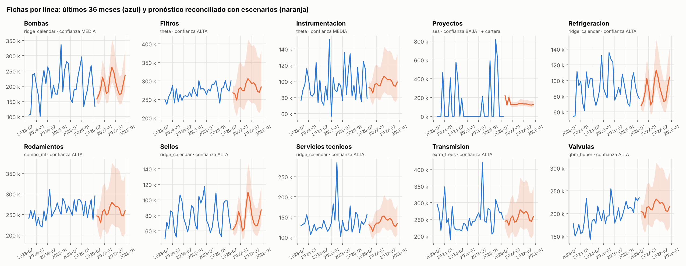
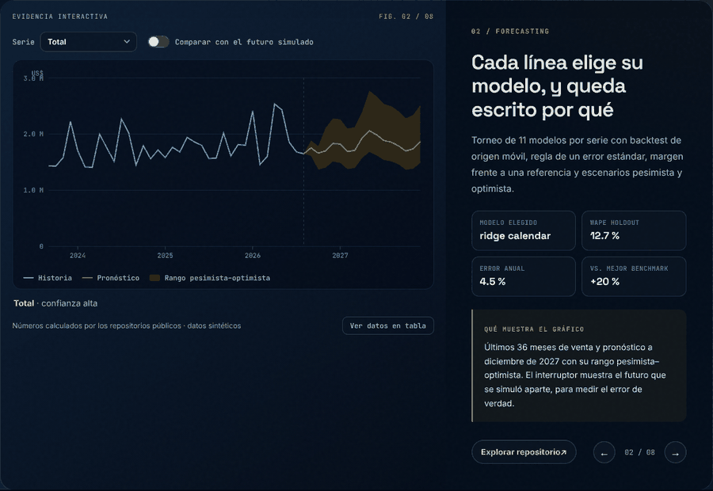
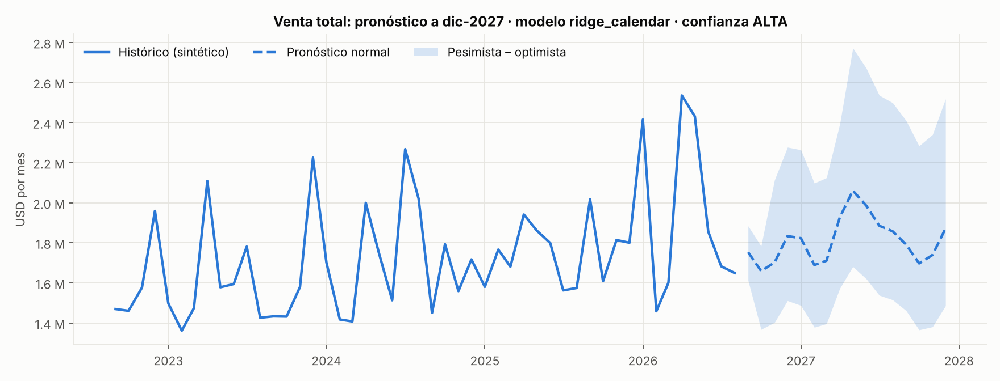
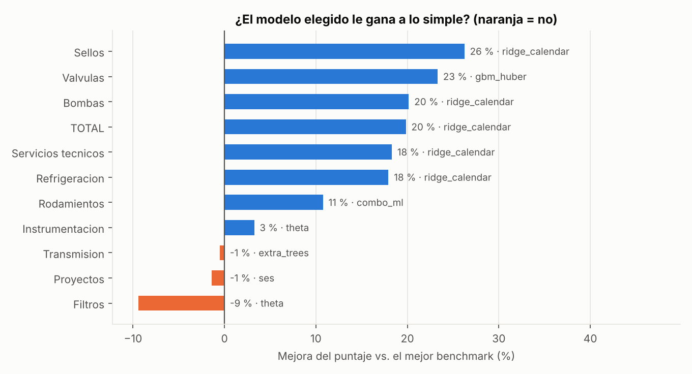

# Forecast adaptativo B2B · Pronóstico por línea con selección auditable de modelos

> **EN —** Monthly sales forecasting for a B2B industrial distributor (10 product lines + total). Each series runs its own model tournament: 11 statistical, ML and intermittent-demand models, 4 ensembles and 3 benchmarks. Selection uses recency-weighted rolling backtests, the one-standard-error rule and a minimum-improvement margin over a statistical reference, confirmed on a holdout window. Two optional layers must each earn their place twice (development and confirmation): an **order-book leading signal** and **real public macro indicators from Peru's central bank (BCRP)**, used with publication lags so nothing peeks into the future. Lines are reconciled to the total, with pessimistic and optimistic scenarios. **Sales and orders are synthetic; the BCRP indicators are real public data.**



## Demo y capturas



> El mismo gráfico es **interactivo** en el [laboratorio de mi portafolio](https://dataross.vercel.app/#laboratorio): mueve los controles y se redibuja con los resultados de este repositorio.



*Total de ventas con escenarios pesimista y optimista.*

## El problema

Planificar compras e inventario de 10 líneas muy distintas: unas son estables, otras estacionales
(siguen las temporadas de pesca), otras dependen de proyectos que llegan una vez cada varios meses.
Un solo modelo para todas falla en silencio. Un modelo "inteligente" que nadie puede explicar no se usa.

**Por eso este motor elige el modelo por serie y deja escrito por qué.**

## Cómo decide

```
Por cada línea y para el total:
  1. Perfil de la serie        → ¿estacionalidad?, ¿ceros?, ¿atípicos? → qué modelos tiene sentido probar
  2. Torneo en desarrollo      → backtest de origen móvil, horizonte de 16 meses, cada 3 meses
  3. Regla de selección        → puntaje ponderado + regla de 1 error estándar + margen vs. referencia
  4. Confirmación (holdout)    → solo desempata entre los empatados; no reabre el torneo
  5. Capa: cartera de pedidos  → entra solo si mejora ≥ 5 % en desarrollo Y se confirma
  6. Capa: indicadores BCRP    → entra solo si mejora ≥ 8 % en desarrollo Y se confirma
  7. Escenarios                → cuantiles del error histórico por horizonte
Al final: reconciliación proporcional de las líneas al total.
```

| Decisión de diseño | Por qué |
|---|---|
| **Los benchmarks nunca pueden ganar**, pero siempre se miden | Si el modelo elegido no supera al promedio de 12 meses, el reporte lo dice con una ALERTA |
| **Regla de 1 error estándar** | Entre modelos estadísticamente empatados gana el más simple |
| **Margen del 3 % frente a SES / Holt / Theta** | Un modelo complejo debe ganarse su complejidad |
| **Puntaje**: 55 % WAPE reciente + 20 % error acumulado + 10 % estabilidad + 15 % sesgo | Las ventanas recientes pesan más, y un modelo inestable o sesgado se penaliza |
| **Error anual** además del WAPE mensual | Para un presupuesto anual importa el total del año, no si la venta cayó en marzo o en abril |
| **Rezago de publicación** en los indicadores BCRP | En un origen solo se usa lo que el BCRP ya había publicado, nunca el dato del futuro |
| **Mezcla sectorial** de cada línea | Una línea solo puede usar indicadores de los sectores a los que vende (minería, pesca, construcción, industria) |
| **Cancelados fuera** de la cartera | Calibración y pronóstico miden el mismo universo |

## Los modelos

| Familia | Modelos |
|---|---|
| Suavizamiento | SES, Holt amortiguado, Holt-Winters (solo si hay estacionalidad), Theta |
| Regresión | Ridge con tendencia y armónicos de calendario |
| ML autoregresivo | Random Forest, Extra Trees, HistGradientBoosting, Gradient Boosting Huber |
| Demanda intermitente | Croston SBA y TSB, con parámetros calibrados |
| Ensambles | Promedio o mediana de familias distintas |
| Benchmarks | Ingenuo, promedio de 12 meses, estacional ingenuo |

## Resultados (ventas sintéticas, corte ago-2026, pronóstico a dic-2027)

| Serie | Modelo elegido | Confianza | WAPE holdout | Error anual promedio | Vs. mejor benchmark |
|---|---|---|---|---|---|
| Bombas | ridge_calendar | Media | 17.3 % | 10.1 % | +20 % |
| Filtros | theta | Alta | 4.0 % | 2.8 % | **−9 % ⚠** |
| Instrumentación | theta | Media | 17.7 % | 8.3 % | +3 % |
| Proyectos *(intermitente)* | ses + cartera | Baja | 134 % | 56 % | **−1 % ⚠** |
| Refrigeración | ridge_calendar | Alta | 10.9 % | 6.7 % | +18 % |
| Rodamientos | combo_ml | Alta | 6.1 % | 2.6 % | +11 % |
| Sellos | ridge_calendar | Alta | 9.2 % | 3.3 % | +26 % |
| Servicios técnicos | ridge_calendar | Alta | 13.0 % | 4.2 % | +18 % |
| Transmisión | extra_trees | Alta | 11.6 % | 9.6 % | **−0.5 % ⚠** |
| Válvulas | gbm_huber | Alta | 10.2 % | 6.4 % | +23 % |
| **Total** | ridge_calendar | Alta | 12.7 % | **4.5 %** | +20 % |



**Lo que muestran los resultados:**

1. **El modelo depende de la serie.** Ganaron 6 modelos distintos. Ridge con calendario fue el más frecuente (5 de 11 series), y los modelos de ML solo ganaron donde superaron el margen.
2. **En 3 líneas, nada le gana a lo simple.** En Filtros, Transmisión y Proyectos el modelo elegido no supera al mejor benchmark. El reporte lo marca con ⚠ en vez de esconderlo.
3. **La cartera de pedidos solo sirvió donde se pide con anticipación.** En Proyectos mejoró 39 % en desarrollo y se confirmó. En las líneas de repuestos, que se piden casi en el mismo mes, habría empeorado el pronóstico hasta 35 %, y el filtro la rechazó. En Servicios técnicos mejoró 35 % en desarrollo, pero no se confirmó en el holdout.
4. **Los indicadores del BCRP no pasaron el filtro en ninguna serie.** En 10 de 11 series habrían empeorado el error en desarrollo (entre 2 % y 40 %). En Proyectos mejoraron 11 %, pero no se confirmaron en el holdout. Con 2 meses de rezago de publicación, la información llega tarde para casi todo el horizonte. Esto también es un resultado: el filtro evitó meter ruido con apariencia de inteligencia.
5. **El error anual es mucho menor que el mensual.** En el total, 4.5 % anual frente a 12.7 % mensual: los errores de cada mes se compensan dentro del año.

### Comparación contra la "verdad" simulada

Como los datos son sintéticos, también simulé el futuro real (sep-2026 a dic-2027) y lo comparé con el pronóstico:

| | Error anual 2027 |
|---|---|
| Total | 0.02 % |
| Filtros · Servicios técnicos · Sellos | 1–3 % |
| Bombas · Refrigeración | 17–25 % (dos líneas con estacionalidad pesquera) |

El total casi perfecto es en parte suerte: los errores de las líneas se compensan entre sí. Por eso el
reporte también muestra el error de cada línea.

## Cómo ejecutarlo

**Con doble clic (Windows):** abre `EJECUTAR_DEMO.bat`. La primera vez instala lo necesario; luego corre todo
(unos 4 minutos) y abre la carpeta de resultados.

**Desde la terminal:**

```bash
pip install -r requirements.txt
python run.py            # regenera los datos sintéticos, corre el motor y guarda reports/
pytest -q                # 31 pruebas
python actualizar_bcrp.py   # opcional: actualiza los indicadores públicos desde la API del BCRP
```

## Salidas (`reports/`)

| Archivo | Contenido |
|---|---|
| `diagnostico_por_serie.csv` | Modelo elegido, por qué se eligió, confianza, capas aceptadas o rechazadas con su motivo y error anual |
| `ranking_modelos.csv` | El torneo completo: puntaje, WAPE, sesgo, estabilidad y error en holdout de cada modelo |
| `forecast_detalle_reconciliado.csv` | Pronóstico mensual por línea: base, cartera, ajuste exógeno, escenarios y factor de reconciliación |
| `forecast_2027_por_linea.csv` | Totales 2027 por escenario |
| `comparacion_vs_verdad_simulada.csv` | Pronóstico frente al futuro simulado |

## Estructura

```
src/forecast/
├── models.py        # registro de modelos + validación del registro al importar
├── selection.py     # perfil de la serie, backtest, ranking (1 error estándar, margen, benchmarks)
├── order_book.py    # cartera de pedidos sin fuga temporal
├── exogenous.py     # indicadores BCRP con rezagos de efecto y de publicación
├── pipeline.py      # capas, confirmación, escenarios, reconciliación
├── metrics.py       # WAPE, sMAPE, sesgo, error anual
├── bcrp.py          # descarga de la API pública del BCRP
├── synthetic.py     # generador de ventas y cartera sintéticas
└── report.py        # gráficos
tests/               # incluye pruebas de NO fuga de información
data/                # ventas y cartera sintéticas + indicadores públicos del BCRP
```

## Datos

- **Ventas y cartera de pedidos:** sintéticas (`src/forecast/synthetic.py`, semilla fija). No provienen de ninguna empresa.
- **Indicadores macro:** reales y públicos, del [BCRP — Estadísticas](https://estadisticas.bcrp.gob.pe/estadisticas/series/) (PBI sectorial, producción minera y pesquera, precios de metales, expectativas empresariales, tipo de cambio). Los códigos de serie están en `data/bcrp_metadata.csv`.

---
**Rosy Napuchi** · Business Intelligence & Data Science · [Portafolio](https://dataross.vercel.app/)
